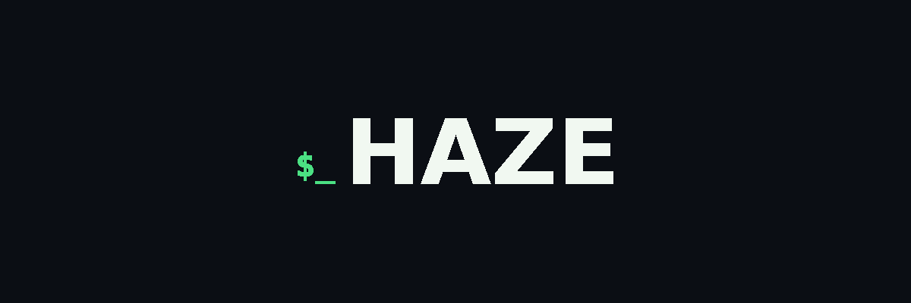

# 🌲 Haze Studios — RP Creator Suite (Emerald Edition v2.0)

<div align="center">
  
  <p><b>A plataforma visual para a comunidade de FiveM & GTA RP: um Editor de imagens com Chat Log cinematográfico, presets de câmera, adesivos forenses e iluminação, mais um conversor de Vídeo para GIF em alta performance.</b></p>
</div>

---

## ⚡ Visão geral

O **Haze RP Studio** roda **100% no navegador** (nada é enviado a servidores) e tem **duas abas**:

| Aba | Para que serve |
|---|---|
| **Editor RP** (Chat Log + Canvas) | Monta a imagem final: foto, chat log, presets de câmera, adesivos, texto, luz e efeitos, tudo no mesmo canvas |
| **Video to GIF Lab** | Converte trechos de vídeo em GIF, com o chat do Editor sobre os quadros |

Construído com **Vite + React 18 + TypeScript + Tailwind CSS**. Deploy contínuo na Vercel.

---

## 🖼️ Editor RP

Um canvas só, uma foto de fundo só. O preview ocupa a janela, ajusta-se sozinho e tem **Modo foco** (`F`) que esconde os controles.

### Chat Log
- **Parser de chat RP** com os formatos `* /me`, `> /ame`, `$` (item/dinheiro), `#` (celular), `!` (sistema), `(( OOC ))`, rádio, `/dispatch` e tons de voz `diz (normal | sussurrando | gritando | baixo | rádio | celular)`.
- **Botões de tom de voz e de marcadores** que inserem no cursor, usando o **personagem ativo**.
- **Contorno estilo GTA**, caixa de fundo semitransparente, sombra, fontes, espaçamento e largura do bloco.
- **Censura** com `||trecho||` em mosaico pixelado ou tarja preta (botão que envolve a seleção).
- **Gerenciador de personagens** com cores e atalhos `Alt+1…9`.

### Foto e cena
- **Resolução e adaptação:** Original, 1280×720, 1920×1080, 2560×1440, 4K, 1:1, 4:5 ou personalizada; modos Cover, Contain e Esticar; pan X/Y e zoom.
- **Retoque:** brilho, contraste, saturação, temperatura, nitidez (Smart Sharpen), Depth of Field e Letterbox 21:9, com presets de color grading.
- **Iluminação & luz colorida:** 10 presets (Boudoir, Sunset, Cyber Purple, Golden Hour, Luar Cyan, Duo-Tone…), 5 tipos de fonte, 7 modos de mistura e arrasto da luz no preview.
- **Câmera RP:** Bodycam (AXON), CCTV e Noite Fria com campos editáveis, mais efeitos de filme (granulado, vinheta, light leak, realce, vintage, P&B).

### Elementos de RP (antigo Canvas Studio)
- **Presets cinemáticos:** Bodycam AXON, Weazel News, FLIR Águia, Dashcam, CCTV e Ficha Criminal.
- **Adesivos forenses:** fita policial, distintivos LSPD/BCSO, marcadores de evidência, perfuração de tiro, mira tática, tarja de censura e carimbo.
- **Texto livre**, com fonte, cor, sombra e contorno.
- **Alças no preview** para mover, redimensionar e girar; rotação com `Shift` em passos de 15°. Cada elemento tem opacidade, mesclagem, travar, duplicar, ordem e a opção de ficar **abaixo do texto do chat**.
- **Camadas de imagem** (logos, molduras, marcas d'água), **salvas no navegador** (IndexedDB).

### Produtividade
- **Barra do mouse** (teclas `1–4`): Texto chat, Enquadrar foto, Mover camada, Posicionar luz. A roda do mouse dá zoom na foto ou muda o tamanho do elemento.
- **Desfazer / Refazer** (`Ctrl+Z` / `Ctrl+Y`) para tudo: texto, estilo, luz, câmera, elementos de RP, **camadas de imagem** e **troca ou remoção da foto de fundo**. Arrastes e sliders contam como um passo só.
- **Salvamento automático** neste navegador: configurações, camadas de imagem e a **foto de fundo** voltam ao recarregar a página.
- **Projeto `.haze`:** 💾 *Salvar projeto* guarda a cena inteira (foto, camadas, chat, ajustes) num arquivo que você abre em qualquer navegador com 📂 *Abrir projeto*. Nada é rasterizado: textos e elementos continuam editáveis. Arquivos inválidos ou de versão futura são recusados com mensagem clara, sem apagar o que está na tela.
- **Exportar PNG 2×** (`Ctrl+S`), **copiar imagem** (`Ctrl+C`) e **Lote (ZIP)** que aplica o chat, a cena e os elementos a várias fotos.

| Atalho | Ação |
|---|---|
| `Ctrl+Z` / `Ctrl+Y` | Desfazer / Refazer |
| `Ctrl+S` / `Ctrl+C` | Exportar / Copiar imagem |
| `1` `2` `3` `4` | Ferramenta do mouse |
| `Alt+1…9` | Inserir fala do personagem nº |
| `F` | Modo foco |
| `Delete` (canvas focado) | Remover o elemento selecionado |
| Setas (canvas focado) | Mover o chat 1 px (`Shift` = 10 px) |
| `?` | Lista de atalhos |

---

## 🎬 Video to GIF Lab

- **Processamento em Web Worker** (`gifWorker.ts`) com buffers transferíveis: a interface não congela.
- **Corte** (início e fim), FPS, velocidade (0,5× a 2×) e formato original ou 1:1.
- **Captura confiável:** se o vídeo não conseguir posicionar um quadro, a conversão para com uma mensagem clara em vez de exportar um quadro repetido.
- **Presets para Discord:** banner de perfil, avatar animado e emoji.
- **Chat do Editor sobre o GIF:** use o texto, os personagens e o estilo criados no Editor; arraste o texto no preview do vídeo, ajuste posição e tamanho e, se quiser, **revele as linhas aos poucos** (efeito de digitação).
- **Marca d'água** de texto opcional.

---

## 🧪 Qualidade

```bash
npm run test:e2e   # suíte de testes (domínio, limites, integração e cenários)
npx tsc --noEmit   # checagem de tipos
npm run build      # build de produção
```

Mais detalhes em [`docs/`](./docs).

---

## 🛠️ Como executar localmente

```bash
npm install
npm run dev      # servidor de desenvolvimento
npm run build    # build de produção (dist/)
```

## 🌐 Deploy na Vercel

1. **Framework Preset:** Vite
2. **Build Command:** `npm run build`
3. **Output Directory:** `dist`

---

## 📁 Estrutura

```
src/
├── components/
│   ├── ChatLog/ChatLogView.tsx        # Editor RP (canvas, painéis, interação)
│   ├── RpElements/                    # painel de presets, adesivos e inspetor
│   ├── GifLab/                        # conversor de vídeo para GIF + worker
│   └── Navbar.tsx
├── utils/
│   ├── chatParser.ts / chatRenderer.ts   # parser e renderizador do chat
│   ├── chatStore.ts                      # chat compartilhado com o GIF Lab
│   ├── canvasLayerRenderer.ts            # desenho e alças dos elementos de RP
│   ├── projectFile.ts                    # arquivo de projeto .haze (validação, salvar, abrir)
│   ├── videoSeek.ts                      # posicionamento do vídeo com retries
│   ├── rpPresets.ts / rpStickers.ts      # presets cinemáticos e adesivos
│   ├── photoFilters.ts                   # retoque fotográfico
│   └── gifEncoder.ts
legacy/index.html   # versão original em HTML único (referência)
docs/               # notas de projeto e de testes
tests/              # suíte de testes
```

---

<div align="center">
  <sub>Desenvolvido com carinho para a <b>Haze Studios</b>.</sub>
</div>
